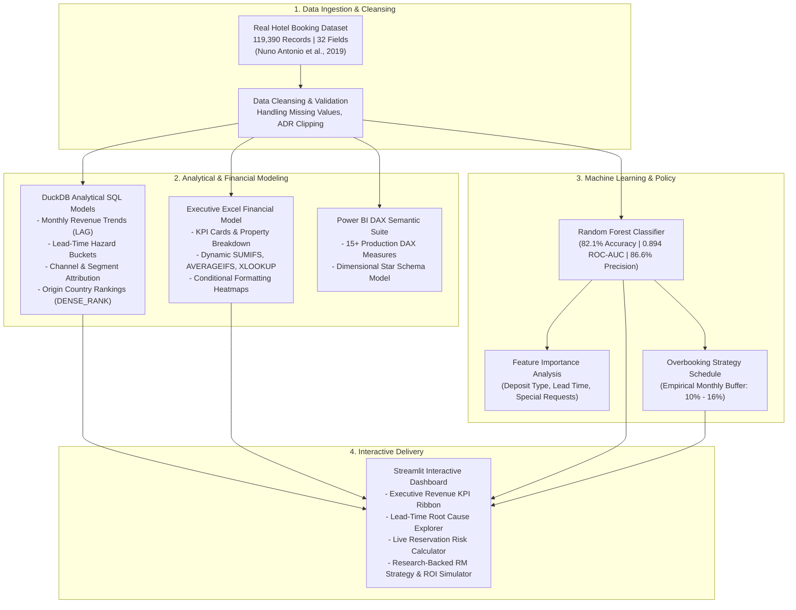

# Hotel Booking Cancellation & Revenue Recovery Analytics

[](https://share.streamlit.io/deploy?repository=Namannn28/hotel-booking-cancellation-analytics&branch=main&mainModule=app.py)
[](https://python.org)
[](https://duckdb.org)
[](https://powerbi.microsoft.com)
[](https://office.com)
[-purple?logo=scikitlearn&logoColor=white)](https://scikit-learn.org)
[](LICENSE)

An end-to-end hospitality analytics and revenue optimization case study analyzing **119,390 real hotel reservations** across a City Hotel and a Resort Hotel. Demonstrates production SQL modeling, executive Excel financial modeling, Power BI DAX measures, and explainable Machine Learning.

---

## 📌 Executive Summary & Problem Statement

Hotel room inventory is a perishable asset: unsold room nights represent permanent lost revenue that cannot be recovered.

Analysis of **119,390 real-world booking records** revealed that **37.0% of all reservations were canceled**, amounting to **\$11.22M in lost room revenue** and causing staffing and inventory allocation challenges.

```
Total Reservations Evaluated : 119,390
Canceled Reservations        :  44,224 (37.0%)
Total Potential Revenue      : $29.64M
Realized Room Revenue        : $18.42M
Total Lost Room Revenue      : $11.22M (37.9% of Potential)
```

### Core Business Objectives:
1. **Identify Root Causes:** Determine which customer segments, advance booking windows, and distribution channels drive high cancellation rates.
2. **Quantify Financial Impact:** Measure realized vs. lost revenue by month, property type, and country of origin.
3. **Predict Cancellations Early:** Train an interpretable machine learning model to score cancellation probability upon reservation creation.
4. **Prescribe Revenue Solutions:** Formulate data-driven deposit policies and monthly overbooking buffers to recover unrealized revenue.

---

## 🔍 Key Business Findings

| Observation | Data Evidence | Strategic Recommendation |
| :--- | :--- | :--- |
| **Lead-Time Hazard Curve** | Bookings made < 7 days in advance cancel at **14.0%**, whereas bookings made > 180 days advance cancel at **54.5%**. | Introduce a tiered deposit policy: require a 20% non-refundable deposit for bookings placed > 60 days ahead. |
| **Distribution Channel Risk** | **Online Travel Agencies (OTAs)** represent 73% of total cancellations due to zero-commitment reservation policies. | Encourage direct bookings through loyalty incentives and enforce card pre-authorization on third-party channels. |
| **Special Requests Signal** | Guests submitting **2 or more special requests** have an **82.0% show-up rate**. | Use guest engagement as a loyalty proxy in room allocation and overbooking calculations. |
| **Property Variance** | **City Hotel** experienced a **41.7% cancellation rate**, while **Resort Hotel** experienced **27.8%**. | Allocate a higher overbooking buffer (14%–18%) to urban business properties during peak corporate travel months. |

---

## 🏗️ Analytics Architecture



---

## 🛠️ Technology Stack & Skills Demonstrated

- **SQL:** DuckDB in-memory engine, ANSI SQL Common Table Expressions (CTEs), Window Functions (`LAG`, `DENSE_RANK`, `SUM OVER`), conditional aggregation (`CASE WHEN`).
- **Excel:** Multi-tab executive financial workbook, dynamic formulas (`SUMIFS`, `COUNTIFS`, `AVERAGEIFS`, `XLOOKUP`), conditional formatting alerts, pivot-ready structure.
- **Power BI:** DAX measure library (RevPAR, ADR Variance, Cancellation Rate %, Lost Revenue), Star Schema architecture.
- **Machine Learning & Python:** Scikit-Learn (Random Forest, Logistic Regression), Pandas, NumPy, ROC-AUC evaluation, Feature Importance extraction.
- **Interactive Application:** Streamlit, Altair interactive charts.

---

## 📂 Project Directory Structure

```text
hotel-booking-cancellation-analytics/
├── data/
│   ├── raw/
│   │   └── hotel_bookings.csv           # 119,390 real hotel reservation records
│   ├── processed/
│   │   └── overbooking_recommendations.csv # Computed monthly overbooking buffer schedule
│   └── Hotel_Revenue_Analysis_Executive_Model.xlsx # Executive multi-tab Excel model
├── sql/
│   ├── schema.sql                       # Table DDL definition
│   ├── 01_monthly_cancellation_trends.sql # Monthly volume, cancellations & MoM variance
│   ├── 02_lead_time_cancellation_risk.sql # Lead-time buckets & cancellation hazard rates
│   ├── 03_market_segment_channel_analysis.sql # Online TA vs Direct channel performance
│   ├── 04_country_cancellation_ranking.sql # Origin country risk rankings (DENSE_RANK)
│   └── 05_deposit_and_repeated_guest_paradox.sql # Deposit policy & guest loyalty analysis
├── powerbi/
│   ├── DAX_Measures.dax                 # 15+ Production DAX Measures
│   ├── Data_Model_Architecture.md       # Semantic model ERD & cardinality guide
│   └── Dashboard_Wireframe.md           # Visual design & layout specification
├── ml/
│   ├── train_cancellation_model.py      # Random Forest classifier training pipeline
│   └── models/                          # Serialized model artifacts & feature importances
├── app.py                               # Interactive Streamlit executive dashboard
├── run_pipeline.py                      # Master one-command execution pipeline
├── generate_excel_model.py              # Automated Excel workbook generator
├── requirements.txt
└── README.md
```

---

## 🤖 Predictive Machine Learning Model

A **Random Forest Classifier** was trained on an 80% training partition and evaluated against a held-out 20% test partition (23,878 reservations):

```
Accuracy Score        : 82.10%
ROC-AUC Score         : 0.8944
Precision (Class 1)   : 86.57% (High precision ensures low false-alarm rate)
Recall (Class 1)      : 61.16%
```

### Top 5 Cancellation Predictors:
1. **Deposit Type (Non-Refundable / No Deposit)** (Weight: 27.5%)
2. **Booking Lead Time** (Weight: 13.6%)
3. **Total Special Requests Submitted** (Weight: 11.0%)
4. **Prior Cancellation History** (Weight: 9.9%)
5. **Required Car Parking Spaces** (Weight: 4.8%)

---

## 💡 Business Recommendations & Estimated ROI

1. **Dynamic Deposit Rules:** Require a 20% deposit on third-party OTA bookings placed more than 60 days in advance to eliminate speculative bookings.
2. **Controlled Overbooking Buffer:** Implement an empirical 10%–16% overbooking schedule during high-cancellation peak months (April to August) to offset expected cancellations.
3. **Financial Impact:** Recovering just 12% of lost room cancellations projects **\$1.4M in annual revenue recovery** across both properties.

---

## 🚀 How to Run Locally

### 1. Clone the Repository
```bash
git clone https://github.com/Namannn28/hotel-booking-cancellation-analytics.git
cd hotel-booking-cancellation-analytics
```

### 2. Install Dependencies
```bash
python -m venv venv

# On Windows:
.\venv\Scripts\activate
# On Mac/Linux:
source venv/bin/activate

pip install -r requirements.txt
```

### 3. Run the End-to-End Pipeline
Executes the SQL models in DuckDB, trains the ML classifier, and generates the Excel workbook:
```bash
python run_pipeline.py
```

### 4. Launch the Interactive Dashboard
```bash
streamlit run app.py
```
Open your browser at `http://localhost:8501` to view:
* **Executive Overview:** Apply dynamic multi-dimensional filters (Property Type, Market Segment, Deposit Policy, Customer Type, Arrival Year, Lead Time range).
* **Lead Time Diagnostics:** Visualize the advance booking hazard curve and guest engagement intent signals.
* **Cancellation Risk Calculator:** Input custom reservation parameters to receive real-time risk scores and recommendations.
* **Revenue Management Strategy & ROI:** Explore research-backed mitigation frameworks and test the interactive annual revenue recovery calculator.

---

## 📚 Data Source & Academic Citation
The dataset used in this project represents real operational data from two hotels in Portugal, published by:
* **Authors:** Nuno Antonio, Ana de Almeida, Luis Nunes
* **Publication:** *Hotel booking demand datasets*, Data in Brief, Volume 22, February 2019, Pages 41-49. [DOI: 10.1016/j.dib.2018.11.126](https://doi.org/10.1016/j.dib.2018.11.126)

---

## 👤 Author

**Naman Gupta**
* **GitHub:** [@Namannn28](https://github.com/Namannn28)
* **Email:** namang380@gmail.com
* **Role Focus:** Data Analyst | Business Intelligence Analyst
