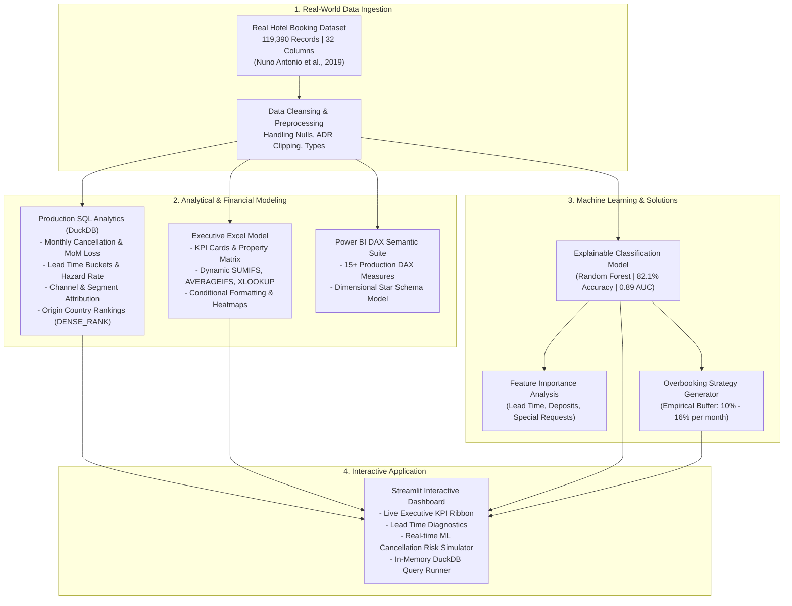

# Hotel Booking Cancellation & Revenue Recovery Analytics

[](https://python.org)
[](https://duckdb.org)
[](https://powerbi.microsoft.com)
[](https://office.com)
[-purple?logo=scikitlearn&logoColor=white)](https://scikit-learn.org)
[](LICENSE)

> **An end-to-end hospitality revenue management and cancellation analytics project built on 119,390 real-world hotel reservations. Designed to demonstrate production SQL, Excel financial modeling, Power BI DAX, and explainable Machine Learning.**

---

## 📌 Business Problem & Overview

Hotel room inventory is a perishable asset: once a night passes, an empty room represents permanent lost revenue. 

Analysis of **119,390 real hotel bookings** across two Portuguese hotels (a City Hotel and a Resort Hotel) revealed an alarming **37.0% overall cancellation rate**, resulting in over **\$11.2M in unrealized room revenue**. 

```
Total Reservations:    119,390
Canceled Bookings:      44,224 (37.0%)
Total Potential Rev:   $29.64M
Realized Room Rev:     $18.42M
Lost Room Revenue:     $11.22M (37.9% of Potential)
```

### Key Business Questions Addressed:
1. **When and Why are guests canceling?** How do lead times, origin countries, and distribution channels influence cancellation likelihood?
2. **What is the financial loss?** How does cancellation revenue loss vary month-over-month between City and Resort hotels?
3. **Can we predict cancellations before they occur?** Can a machine learning model accurately flag high-risk reservations at booking time?
4. **How can revenue managers recover this lost revenue?** What dynamic deposit rules and safe overbooking percentages should be implemented?

---

## 🏗️ Analytics Architecture



---

## 🔍 Core Analytical Discoveries

| Finding / Driver | Data Evidence | Strategic Solution |
| :--- | :--- | :--- |
| **Lead Time Hazard Curve** | Bookings made within 7 days cancel at **14.0%**, while bookings made >180 days advance cancel at **54.5%**. | Implement tiered deposit requirements for reservations made >60 days in advance. |
| **Distribution Channel Risk** | **Online Travel Agencies (OTAs)** account for 73% of total cancellations due to zero-commitment reservation policies. | Introduce direct booking incentives and require credit card pre-authorization on third-party channels. |
| **Special Requests Signal** | Guests submitting **2+ special requests** (e.g. high floor, twin beds) exhibit an **82% show-up rate**. | Use special requests as an indicator of guest commitment in revenue allocation models. |
| **Property Variance** | **City Hotel** experienced a **41.7% cancellation rate**, whereas **Resort Hotel** experienced **27.8%**. | Apply higher overbooking thresholds (14-18%) to urban business hotels during weekdays. |

---

## 🛠️ Tech Stack & Skills Demonstrated

- **SQL:** DuckDB in-memory execution, ANSI SQL CTEs, Window Functions (`LAG`, `DENSE_RANK`, `SUM OVER`), conditional aggregation (`CASE WHEN`).
- **Excel:** Advanced formulas (`SUMIFS`, `COUNTIFS`, `AVERAGEIFS`, `XLOOKUP`), multi-tab executive formatting, sensitivity matrix, pivot-ready design.
- **Power BI:** DAX library (15+ measures: RevPAR, ADR Variance, Cancellation Rate %, Lost Revenue), Star Schema modeling.
- **Machine Learning & Python:** Scikit-Learn (Random Forest Classifier, Logistic Regression), Pandas, NumPy, ROC-AUC evaluation, Feature Importance.
- **Interactive Delivery:** Streamlit, Altair Charts, GitHub CLI.

---

## 📂 Repository Structure

```text
hotel-booking-cancellation-analytics/
├── data/
│   ├── raw/
│   │   └── hotel_bookings.csv           # 119,390 real booking records
│   ├── processed/
│   │   └── overbooking_recommendations.csv # Computed monthly overbooking buffer %
│   └── Hotel_Revenue_Analysis_Executive_Model.xlsx # Stylized multi-tab Excel model
├── sql/
│   ├── schema.sql                       # DDL schema definition
│   ├── 01_monthly_cancellation_trends.sql # Monthly volume, cancellations & MoM variance
│   ├── 02_lead_time_cancellation_risk.sql # Lead time buckets & hazard curves
│   ├── 03_market_segment_channel_analysis.sql # Online TA vs Direct channel performance
│   ├── 04_country_cancellation_ranking.sql # Origin country risk rankings (DENSE_RANK)
│   └── 05_deposit_and_repeated_guest_paradox.sql # Deposit policy & loyalty analysis
├── powerbi/
│   ├── DAX_Measures.dax                 # 15+ Production DAX Measures
│   ├── Data_Model_Architecture.md       # Semantic model ERD & cardinality guide
│   └── Dashboard_Wireframe.md           # Visual design & layout specification
├── ml/
│   ├── train_cancellation_model.py      # Random Forest classifier training pipeline
│   └── models/                          # Saved model artifacts & feature importances
├── app.py                               # Interactive Streamlit executive dashboard
├── run_pipeline.py                      # One-command master runner
├── generate_excel_model.py              # Automated Excel workbook generator
├── RESUME_BULLETS.md                    # Tailored ATS resume bullet points
├── INTERVIEW_TALKING_POINTS.md          # 12+ STAR technical interview questions & answers
├── requirements.txt
└── README.md
```

---

## 🤖 Machine Learning Model Summary

A Random Forest Classifier was trained on 80% of the dataset and evaluated on a held-out 20% test set (23,878 reservations):

```
Accuracy Score   : 82.1%
ROC-AUC Score    : 0.8944
Precision (Class 1): 86.6% (Low false alarm rate protects guest trust)
Recall (Class 1)   : 61.2%
```

### Top 5 Predictive Features:
1. **Deposit Type (Non-Refundable / No Deposit)** (Weight: 27.5%)
2. **Lead Time Window** (Weight: 13.6%)
3. **Total Special Requests Submitted** (Weight: 11.0%)
4. **Previous Cancellation History** (Weight: 9.9%)
5. **Required Parking Spaces** (Weight: 4.8%)

---

## 🚀 How to Run Locally

### 1. Clone the Repository
```bash
git clone https://github.com/Namannn28/hotel-booking-cancellation-analytics.git
cd hotel-booking-cancellation-analytics
```

### 2. Install Dependencies
```bash
python -m venv venv
# On Windows:
.\venv\Scripts\activate
# On Mac/Linux:
source venv/bin/activate

pip install -r requirements.txt
```

### 3. Run the Complete Pipeline
Executes all SQL queries via DuckDB, trains the ML model, and generates the Excel workbook:
```bash
python run_pipeline.py
```

### 4. Launch the Interactive Dashboard
```bash
streamlit run app.py
```
Open `http://localhost:8501` to test:
- **Executive Revenue Dashboard:** Filter between City and Resort hotels, view monthly revenue trends.
- **Lead Time Root Cause Explorer:** View cancellation hazard rates.
- **Live ML Cancellation Simulator:** Adjust booking sliders (lead time, deposit type, special requests) to predict cancellation probability live.
- **DuckDB SQL Query Explorer:** Inspect and run the production SQL queries in real-time.

---

## 📄 Resume & Interview Preparation Kit

- 💼 **[RESUME_BULLETS.md](RESUME_BULLETS.md):** Pre-written, metric-backed bullet points formatted for ATS resumes.
- 🎙️ **[INTERVIEW_TALKING_POINTS.md](INTERVIEW_TALKING_POINTS.md):** 12+ real-world interview questions with full STAR answers you can speak through in hiring rounds.

---

## 📚 Data Source & Academic Citation
The dataset used in this project is real-world operational data from two hotels in Portugal, published by:
- **Authors:** Nuno Antonio, Ana de Almeida, Luis Nunes
- **Publication:** *Hotel booking demand datasets*, Data in Brief, Volume 22, February 2019, Pages 41-49. [DOI: 10.1016/j.dib.2018.11.126](https://doi.org/10.1016/j.dib.2018.11.126)

---

## 👤 Author

**Naman Gupta**
- **GitHub:** [@Namannn28](https://github.com/Namannn28)
- **Email:** namang380@gmail.com
- **Role Target:** Data Analyst | Junior Data Analyst | BI Analyst
