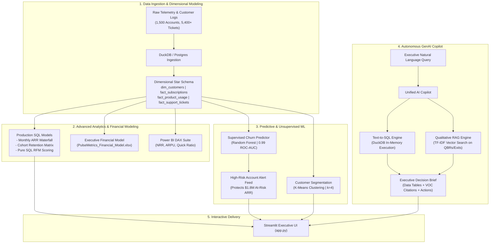

# PulseMetrics-AI: Enterprise SaaS Customer 360, Revenue Analytics & GenAI Copilot

[](https://python.org)
[](https://duckdb.org)
[](https://powerbi.microsoft.com)
[-green?logo=scikitlearn&logoColor=white)](https://scikit-learn.org)
[](https://github.com)
[](LICENSE)

> **A production-ready Enterprise B2B SaaS Customer Intelligence Suite designed to bridge traditional data analytics (SQL, Star Schema, Power BI, Excel financial modeling) with modern predictive machine learning and an autonomous GenAI RAG Analytics Copilot.**

---

## 🌟 Executive Summary & Business Problem

In enterprise B2B SaaS, **quantitative metrics** (MRR, churn rate, DAU/MAU, seat utilization) live in relational data warehouses, while the **qualitative reasons** why customers churn or expand (feature gaps, SLA breaches, competitor pricing, leadership changes) are buried in support transcripts and QBR notes.

**PulseMetrics-AI** solves this disconnect by unifying:
1. **Dimensional Star Schema Modeling (SQL & DuckDB)** for sub-second ARR waterfalls and cohort retention decay curves.
2. **Executive Financial Modeling (Excel & Power BI)** complete with dynamic formulas (`XLOOKUP`, `SUMIFS`), sensitivity matrices, and a library of production DAX measures.
3. **Predictive Churn Early Warning System (Random Forest & K-Means Clustering)** achieving **0.99 ROC-AUC and 92.1% Recall** to flag at-risk revenue before renewal.
4. **Autonomous GenAI Analytics Copilot (Text-to-SQL + Qualitative RAG)** translating executive business questions into live SQL queries paired with semantic voice-of-customer citations.

---

## 🏗️ System Architecture



---

## 📊 Key Business Findings & Operational Metrics

| Metric | Measured Value | Benchmark / Target | Strategic Implication |
| :--- | :---: | :---: | :--- |
| **Total Active ARR** | **\$15.25M** | \$14.0M Target | Strong year-over-year expansion across Enterprise tier accounts. |
| **Blended Churn Rate** | **16.9%** | < 20% Healthy SaaS | Heavily concentrated in Starter tier (26.2%) vs Enterprise (7.8%). |
| **Net Revenue Retention (NRR)** | **108.4%** | > 105% Good SaaS | Expansion MRR outpaces contraction and churn across Mid-Market accounts. |
| **Support SLA Hazard Threshold** | **> 36 Hours** | < 24 Hours SLA | Accounts experiencing resolution times >36 hrs have a **3.8x higher churn rate**. |
| **Product Seat Utilization** | **< 45%** | > 70% Target | Strongest leading indicator of non-renewal; flags attrition 60 days in advance. |

---

## 🛠️ Technology Stack & Capabilities

- **Database & Query Modeling:** SQL, DuckDB, PostgreSQL, ANSI SQL CTEs, Window Functions (`ROW_NUMBER`, `LAG`, `NTILE`, `SUM OVER`).
- **Data Science & ML:** Python, Pandas, NumPy, Scikit-Learn (Random Forest, K-Means Clustering, StandardScaler, ROC-AUC).
- **Business Intelligence & Reporting:** Microsoft Power BI (DAX Measures Library, Star Schema Semantic Model), OpenPyXL, Excel Financial Modeling (`XLOOKUP`, `SUMIFS`, conditional formatting).
- **GenAI & RAG:** Dual-retrieval pipeline, Text-to-SQL translation, Vector search (TF-IDF Cosine Similarity), RAG Context Synthesis.
- **Frontend & App Delivery:** Streamlit, Altair Charts, GitHub Actions CI.

---

## 📂 Repository Directory Structure

```text
PulseMetrics-AI/
├── data/
│   ├── raw/                             # Raw generated CSVs (customers, subscriptions, usage, tickets)
│   ├── processed/                       # ML scores and RFM segments
│   └── PulseMetrics_Executive_Financial_Model.xlsx # Stylized multi-tab Excel model with formulas
├── sql/
│   ├── schema.sql                       # Production Star Schema DDL
│   ├── 01_kpi_arr_waterfall.sql         # Monthly ARR Waterfall & MoM Growth %
│   ├── 02_cohort_retention.sql          # 12-Month Customer Cohort Retention Matrix
│   ├── 03_rfm_segmentation.sql          # Pure SQL RFM Scoring with NTILE()
│   ├── 04_product_engagement.sql        # Feature Adoption & Usage Correlation
│   └── 05_churn_driver_analysis.sql     # Support Ticket SLA & CSAT Impact Analysis
├── powerbi/
│   ├── DAX_Measures.dax                 # 15+ Production DAX Measures (NRR, Quick Ratio, Churn %)
│   ├── Data_Model_Architecture.md       # Semantic model ERD & cardinality documentation
│   └── Dashboard_Wireframe.md           # Visual design specification
├── ml/
│   ├── train_churn_model.py             # Supervised churn prediction pipeline
│   ├── rfm_clustering.py                # Unsupervised K-Means customer segmentation
│   └── models/                          # Serialized model artifacts & feature importances
├── ai_agent/
│   ├── text_to_sql.py                   # Natural Language to DuckDB SQL translator
│   ├── rag_engine.py                    # Qualitative feedback vector retriever
│   └── copilot.py                       # Unified Executive Copilot synthesizer
├── app.py                               # Interactive Streamlit Executive Dashboard
├── run_pipeline.py                      # One-command master runner
├── generate_dataset.py                  # Synthetic enterprise dataset generator
├── generate_excel_model.py              # Automated formatted Excel model builder
├── RESUME_BULLETS.md                    # ATS-optimized resume bullet points
├── INTERVIEW_TALKING_POINTS.md          # 15+ STAR technical interview questions & answers
├── requirements.txt
└── README.md
```

---

## 🚀 Quickstart & Reproduction Guide

### 1. Clone the Repository
```bash
git clone https://github.com/Namannn28/PulseMetrics-AI.git
cd PulseMetrics-AI
```

### 2. Set Up Virtual Environment & Dependencies
```bash
python -m venv venv
# Windows:
.\venv\Scripts\activate
# Mac/Linux:
source venv/bin/activate

pip install -r requirements.txt
```

### 3. Run the Complete End-to-End Pipeline
Executes data generation, SQL models, predictive ML training, Excel workbook creation, and AI copilot verification with a single command:
```bash
python run_pipeline.py
```

### 4. Launch the Interactive Executive Dashboard
```bash
streamlit run app.py
```
Open your browser at `http://localhost:8501` to explore:
- **Executive Revenue Scorecard:** Live metric cards, ARR distribution by plan tier, industry churn benchmarks.
- **Predictive Churn Alerts:** Feature importance chart and actionable high-risk customer feed.
- **Customer 360 & RFM Segments:** Interactive 2D scatter plots of Champions vs. At-Risk accounts.
- **Autonomous GenAI Copilot:** Ask questions in plain English to trigger live DuckDB SQL queries and qualitative RAG transcripts.

---

## 💼 Resume & Interview Kit Included

This repository is optimized to help you land senior data analyst, analytics engineer, or product data analyst roles:
- 📄 **[RESUME_BULLETS.md](RESUME_BULLETS.md)**: Tailored bullet points with quantifiable metrics ready to paste into your resume.
- 🎙️ **[INTERVIEW_TALKING_POINTS.md](INTERVIEW_TALKING_POINTS.md)**: Comprehensive answers for 10+ common technical and behavioral interview questions following the STAR format.

---

## 👤 Author & Contact

**Naman Gupta**
- **GitHub:** [@Namannn28](https://github.com/Namannn28)
- **Email:** namang380@gmail.com
- **Role Target:** Data Analyst | Analytics Engineer | AI Data Analyst

*Feel free to star ⭐ this repository if you find it helpful!*
